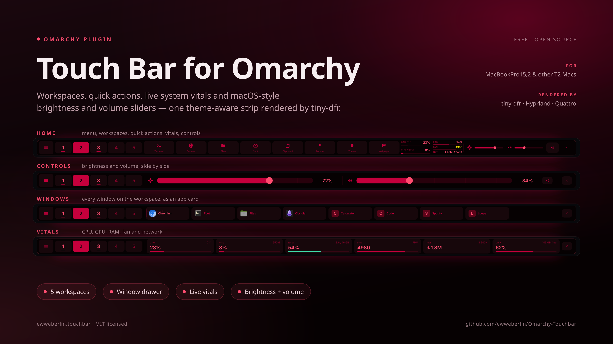
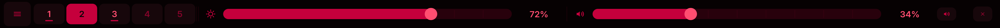
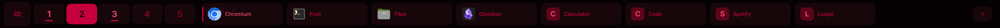
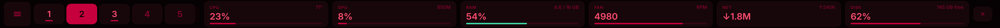

# Touch Bar for Omarchy




☕ **If you like this project, buy me a coffee** → [paypal.me](https://paypal.me/EwgeniWeber)


A theme-aware control strip that turns the Touch Bar of an Intel/T2 MacBook
into a useful part of an [Omarchy](https://omarchy.org/) desktop: workspaces,
quick actions, a window drawer, live system vitals and macOS-style brightness
and volume sliders.

The whole strip is one SVG rendered by [`tiny-dfr`](https://github.com/WhatAmISupposedToPutHere/tiny-dfr)
and painted on the Touch Bar. It follows the active Omarchy theme, so there is
nothing to style by hand.

[](docs/screenshots/home.png)
*Home — menu, five workspaces, quick actions, system vitals and the control strip.*

[](docs/screenshots/controls.png)
*Controls — brightness and volume side by side, with mute and close.*

[](docs/screenshots/windows.png)
*Windows — every window on the active workspace, with app icons.*

[](docs/screenshots/vitals.png)
*Vitals — CPU, GPU, RAM, fan, network, disk and free space.*

> Built for **MacBookPro15,2** (13″ 2018, i5-8279U, Iris Plus 655) running
> Omarchy on Hyprland with the `arch-mact2` kernel. Other T2 Macs with a Touch
> Bar should work, but the sensor names and panel dimensions in this README are
> the ones verified on that machine.

## Features

- **Home strip**: Omarchy menu, five workspace cells, Terminal, Browser, Files,
  Screenshot, Clipboard, Dictation, Theme Switcher, Wallpaper, a compact system
  block and a control strip.
- **Workspaces** light up when occupied and follow Hyprland immediately through
  its event socket.
- **Window drawer**: tap the active workspace to see every window on it with
  its app icon. Tap a card to focus it, drag the row to scroll, tap outside or
  wait eight seconds to close.
- **Controls drawer**: brightness and volume side-by-side, each with tick marks
  and a macOS-style percentage readout, plus a mute toggle.
- **System vitals**: CPU temperature + usage, GPU clock + usage, RAM, fan and
  network in two compact stacks. Tap the block for six large cards (adds disk
  usage and free space).
- **Fn stays Fn**: holding Fn shows the normal F1–F12 row; the custom strip is
  the default layer and repaints as soon as Fn is released.
- **Theme live**: colours come from Omarchy's `colors.toml`; the theme-set hook
  asks the daemon to repaint as soon as a theme is applied.
- **Theme and wallpaper pickers**: the Theme and Wallpaper buttons run the same
  commands as Omarchy's own menu, so picking an entry applies it right away.

## Requirements

- Omarchy with the Quickshell shell (`omarchy-shell`) on Hyprland
- `arch-mact2` and the **`tiny-dfr`** package (`sudo pacman -S tiny-dfr`)
- Python 3.11+ (**stdlib only**, no pip packages)
- `rsvg-convert`, `brightnessctl`, `pactl`, `hyprctl`, `omarchy`

`tiny-dfr` is what owns the Touch Bar. This plugin is a **service-only** shell
plugin: a QML supervisor keeps a Python daemon alive, and the daemon publishes
SVG frames plus tiny-dfr's config. There is no bar widget.

## Installation

### The Omarchy way

```sh
omarchy plugin add https://github.com/ewweberlin/Omarchy-Touchbar.git --enable
cd ~/.config/omarchy/plugins/ewweberlin.touchbar
bin/install
```

Running `bin/install` from the cloned plugin directory is still required for the
hook, udev rule and `/etc/tiny-dfr` permissions.

### After installing tiny-dfr

Installing tiny-dfr re-enumerates the Touch Bar USB device. If the digitizer node
does not appear after a re-login, **reboot**. Then check:

```sh
ls -l /dev/input/event* | grep -i touch
omarchy plugin list
journalctl --user -u omarchy-shell -f | grep -i touchbar
```

### From a checkout

```sh
sudo pacman -S tiny-dfr

git clone https://github.com/ewweberlin/Omarchy-Touchbar.git
cd Omarchy-Touchbar
bin/install
```

`bin/install` is idempotent. It:

1. copies the manifest, `Service.qml` and `daemon/` into
   `~/.config/omarchy/plugins/ewweberlin.touchbar` (a copy rather than a
   symlink, because `omarchy plugin validate` rejects symlinked plugin folders)
2. enables the plugin in `~/.config/omarchy/shell.json` (via the official
   `omarchy plugin enable` command when the shell is running)
3. installs the theme-set hook
4. installs a udev rule for the Touch Bar digitizer and the internal keyboard
5. gives your user write access to `/etc/tiny-dfr` so the daemon can publish
   frames atomically
6. enables `tiny-dfr.service` if the package ships it

Use `bin/install --no-system` to skip the sudo steps, `--dry-run` to see the
plan without changing anything, or `--link` to symlink this checkout instead of
copying it (handy while developing the daemon; validation then checks the
checkout itself, since the validator refuses the symlinked folder).

## Using it

| Where | Tap | Drag |
|---|---|---|
| Home | menu, workspace, quick action | brightness or volume bar |
| Home → system block | open vitals | — |
| Home → sun or chevron | open controls | — |
| Controls | mute, close, or a point on a slider | either slider |
| Windows | focus a window | scroll the row |
| Vitals | a card (keeps it open) | — |

Anywhere in a drawer, tapping outside the drawer or waiting eight seconds
returns to the home strip. Drawer idle-close can be disabled in the settings.

Holding **Fn** switches tiny-dfr to its normal function-key layer. The daemon
stops publishing while Fn is held, because a tiny-dfr config reload would force
the layer back to the media layer. When Fn is released the latest frame is
published again.

## Configuration

Everything is optional. Create `~/.config/omarchy-touchbar/config.json`:

```json
{
  "idle_close_ms": 8000,
  "max_fps": 12,
  "slider_step": 2,
  "workspace_count": 5,
  "workspace_first": 1,
  "window_icons": true,
  "busy_seconds": 30,
  "sleep_seconds": 300,
  "font_family": "Adwaita Sans, Noto Sans, Liberation Sans, sans-serif",
  "invert_x": false,
  "invert_y": false,
  "swap_xy": false,
  "x_offset": 0,
  "y_offset": 0
}
```

| Key | Meaning |
|---|---|
| `idle_close_ms` | Close a drawer after this much idle time. `0` disables it. |
| `max_fps` | Redraw budget. Every redraw re-parses the SVG in tiny-dfr. |
| `slider_step` | Volume slider resolution, in percent. |
| `workspace_count` | Workspaces shown (1–9; more would squeeze the actions). |
| `workspace_first` | ID of the leftmost workspace. |
| `window_icons` | Resolve app icons for the window drawer. |
| `busy_seconds` | Sample every second for this long after the last touch. |
| `sleep_seconds` | Stop sampling after this much idle time until the next touch. |
| `font_family` | Font stack used inside the SVG. |
| `invert_x`, `invert_y`, `swap_xy`, `x_offset`, `y_offset` | Touch calibration. |

Restart the shell after editing the file:

```sh
omarchy restart shell
```

### Touch calibration

This panel's digitizer is a single row: it reports x only, so y is pinned to the
middle of the canvas. If taps land mirrored or offset horizontally, the axis is
oriented differently from the default. The defaults assume panel x grows to the
right and canvas x maps `raw / max * 2170 - 91`. Try, one change at a time:

```json
{"invert_x": true}
{"x_offset": 40}
```

The offset is in canvas pixels after inversion, so `x_offset: 40` moves every
touch 40 px to the right. `invert_y`, `swap_xy` and `y_offset` only matter on a
digitizer that reports a real y axis.

## How it works

`tiny-dfr` force-inserts an `esc` cell at index 0 of both layers. With
`Stretch = 23` and a 2170×60 panel, the single stretched button starts at panel
x = 91 and is 2079 px wide. The plugin renders into that **2079×60 canvas** and
sets `IconWidth = 2079`, `IconHeight = 60` so the SVG fills the button.

Two tiny-dfr behaviours drive the design:

- **SVGs are cached at config load.** Changing the file on disk does nothing
  until `/etc/tiny-dfr/config.toml` is rewritten. A repaint is therefore an
  atomic SVG write followed by an atomic config rewrite (tiny-dfr watches the
  config for `IN_MOVED_TO`), which is why `bin/install` needs directory write
  access to `/etc/tiny-dfr`.
- **A config reload clears the touch map.** The stretched button deliberately
  has **no `Action`**: tiny-dfr is a pure display and all input comes from the
  daemon's own evdev read. That is what makes live slider redraws safe.

The daemon coalesces repaints, skips identical frames, suppresses paints while
Fn is down, and keeps a slow system sampler when idle.

### The digitizer is one row

The Touch Bar digitizer (`Apple Inc. Touch Bar Display Touchpad`) advertises
both single-touch and multitouch axes, but a contact emits only `ABS_X`. Y is
therefore pinned to the middle of the canvas, and every control has to be
reachable by x alone — which is why brightness and volume sit side by side
instead of in two stacked rows.

The node lives on `seat-touchbar`, so logind never grants the session a uaccess
ACL for it. `bin/install` installs a udev rule that hands the digitizer and the
internal keyboard (which carries Fn) to the installing user as `OWNER`,
`GROUP=input`, `MODE=0660`.

### Sensors used

| Value | Source |
|---|---|
| CPU temperature | `coretemp` hwmon, package sensor |
| CPU usage | `/proc/stat` delta |
| GPU usage | `drm-engine-render` deltas from `/proc/*/fdinfo` |
| GPU clock | `/sys/class/drm/card*/gt_cur_freq_mhz` |
| RAM | `/proc/meminfo` |
| Fan | applesmc `fan*_input`; highest fan against its own ceiling |
| Network | default-route interface `rx_bytes`/`tx_bytes` delta |
| Disk (vitals drawer) | `statvfs("/")` |


### Repository layout

| Path | What it is |
|---|---|
| `manifest.json`, `Service.qml` | the shell plugin: a supervisor that keeps the daemon alive |
| `daemon/` | the runtime: layout, renderer, state machine, input, sensors, Hyprland bridge |
| `bin/install`, `bin/uninstall` | install the plugin, hook, udev rule and `/etc/tiny-dfr` permissions |
| `hooks/10-omarchy-touchbar` | theme-set hook that asks the daemon to repaint |
| `udev/90-omarchy-touchbar.rules` | device permissions for the digitizer and internal keyboard |
| `docs/screenshots/` | the preview images above |

### Design conventions

- **Standard library only.** The daemon imports nothing outside Python 3.11+
  and never writes into the plugin folder at runtime (no `__pycache__`, which
  the shell watches).
- **One geometry source.** `daemon/layout.py` is the only layout function:
  the renderer and the hit-tester both call it, so a drawn button and its touch
  zone cannot drift apart.
- **Flat SVG.** tiny-dfr re-parses the file on every repaint, so the frame stays
  small: plain rectangles and paths, inline icons, no filters, blur or large
  embedded bitmaps.
- **Service-only plugin.** `kinds` is `["service"]`; there is no bar widget.
  QML follows Omarchy's plugin rules (`Text.PlainText`, `Style.duration()`), and
  nothing outside the plugin's own folder is edited.
- **Comments explain why.** The tiny-dfr and Omarchy quirks behind a workaround
  are recorded next to it.

## Troubleshooting

**The Touch Bar shows only esc / stays blank.**
Install `tiny-dfr`, reboot so the USB device re-enumerates, then run
`bin/install` again. Check `journalctl --user -u omarchy-shell -f | grep touchbar`
for a publish-permission error.

**The strip appears but taps do nothing.**
The digitizer node is not readable by your user. Check
`ls -l /dev/input/event*`; the Touch Bar node should be owned by you with mode
`0660`. Re-run `bin/install` and `sudo udevadm trigger --subsystem-match=input`.

**A button never reacts, but brightness and volume do.**
Run the daemon in the foreground to see every touch coordinate and where it
lands:

```sh
omarchy plugin disable ewweberlin.touchbar
python3 -B -m daemon --verbose   # from the checkout
```

Stop the installed daemon first: two daemons both act on the same tap, so
quick actions would run twice.

**The theme does not change.**
Confirm `~/.config/omarchy/hooks/theme-set.d/10-omarchy-touchbar` exists and is
executable. It touches a runtime file the daemon watches; the daemon also
notices a changed `colors.toml` on its own.

**The bar dims after a while.**
tiny-dfr dims after 30 seconds without input and turns the bar off after 60;
at backlight level 0 it also discards touches, so this is not cosmetic. The
daemon keeps `appletb_backlight` at full while the lid is open; install
`brightnessctl` if it is missing.

**Fn gets stuck on the function row.**
tiny-dfr repaints its own layer on a config reload, so the daemon suppresses
paints while Fn is down. If it still happens, check that the internal keyboard
node is the one the daemon opened (its log prints the path), then release and
press Fn once more.

## Uninstall

```sh
bin/uninstall
omarchy restart shell
```

This removes the plugin copy (or symlink), the shell entry, the theme hook, the
udev rule, the generated SVG and a generated `config.toml`. It deliberately
leaves the `tiny-dfr` package, `/usr/share/tiny-dfr`, your settings file and a
git-managed plugin directory (remove that with
`omarchy plugin remove ewweberlin.touchbar`).

## Credits

The macOS-style slider and Touch Bar control
strip were adapted from **[niraj-envision/touch-bar](https://github.com/niraj-envision/touch-bar)**
by Niraj Kumar Dahal, MIT licensed. This project is a Python/Omarchy rewrite:
the layout, renderer, input path, theme loading, Hyprland integration and
tiny-dfr publishing are new, and non-Omarchy extras were left out.

The rendering path relies on **tiny-dfr** by the arch-mact2 project.

## License

MIT. Copyright © 2026 Ewgeni Weber. Third-party notices are in
[`LICENSE`](LICENSE).
